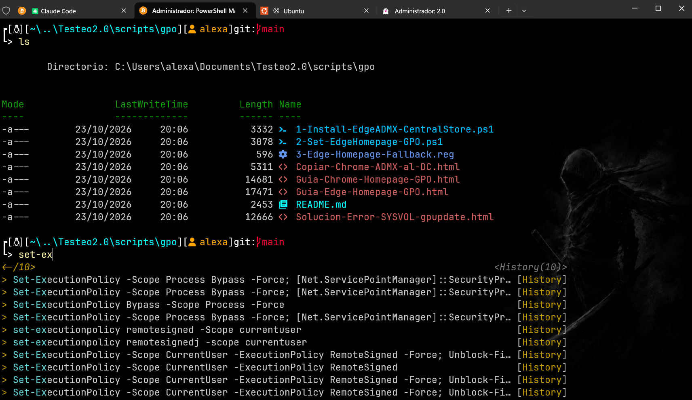

<table align="center">
<tr>
<td width="340" align="center">

</td>
<td valign="middle">

### VORTERM 7.4

**From clean Windows to modern dev shell**
*one click*


[Install](#-install) · [Stack](#-stack) · [Multi-pane](#-multi-pane) · [Session restore](#️-session-restore) · [Claude Code config](#-claude-code-config) · [Lab](#-lab-optional) · [Claude Code](#-claude-code-companion) · [Reset](#-reset)

</td>
</tr>
</table>

---

## ⚡ Install

One command in PowerShell: downloads the latest Vorterm and opens it. Nothing is installed until you press **INSTALL**.

```powershell
Set-ExecutionPolicy -Scope Process Bypass -Force; [Net.ServicePointManager]::SecurityProtocol=3072; $f="$env:TEMP\vorterm-bootstrap.ps1"; irm https://raw.githubusercontent.com/4leX-42/Vorterm/main/bootstrap.ps1 -OutFile $f; & $f
```

Or download the repository and double-click:

```bat
INSTALAR.bat
```

Re-running either is safe: anything already in place is left alone.

Unattended (no window), for new machines or scripts:

```powershell
powershell -ExecutionPolicy Bypass -STA -File .\setup_terminal.ps1 -NoGui
powershell -ExecutionPolicy Bypass -STA -File .\setup_terminal.ps1 -NoGui -Node -ClaudeCode -LabRoot "$env:USERPROFILE\Desktop"
```

Full options, updates and recovery: [docs/INSTALL.md](docs/INSTALL.md).

<br/>

<div align="center">
  
  <br/>
  <sub><i>PowerShell 7 · oh-my-posh · Nerd Font · Terminal-Icons</i></sub>
</div>

<br/>

---

## 📦 Stack

> Silent · sequential &amp; retry-safe · winget-powered · idempotent

<table align="center">
<tr>
<td valign="top" width="50%">

**Core**

<sub>
PowerShell 7<br/>
Windows Terminal<br/>
Git
</sub>

</td>
<td valign="top" width="50%">

**Shell experience**

<sub>
oh-my-posh + <code>Mainthema</code> (bundled, offline)<br/>
JetBrainsMono Nerd Font<br/>
PSReadLine · Terminal-Icons · posh-git
</sub>

</td>
</tr>
</table>

Your PowerShell profile keeps everything you wrote: Vorterm only manages its own block
between `# >>> vorterm >>>` and `# <<< vorterm <<<`.

---

## 🧩 Optional

`VS Code` · `Neovim` · `7-Zip` · `GitHub Desktop` · `WSL` · `Node.js LTS` · `Claude Code` · `Codex CLI` · `Antigravity`

---

## 🪟 Multi-pane

One Windows Terminal window, several panes of a hidden black profile (no background image,
so text stays readable). On by default.

| Command | What it does |
| :-- | :-- |
| `m2` / `m3` / `m4` | 2 or 3 columns, or a 2x2 grid, maximized |
| `-Rows` | stack the panes as rows (vertical monitor) |
| `-Claude` | start Claude Code in every pane |
| `close 2` | close pane 2 from any pane (`close 2 3` for several) |
| `/commands` | cheat sheet in the terminal |
| `Ctrl+Shift+3 / B / Z` | split in 3 · type in all panes · zoom pane (only if the keys were free) |

---

## ♻️ Session restore

After a reboot, a crash or a forced close, Windows Terminal reopens its tabs and panes,
each one goes back to its folder and resumes the Claude Code session it had open
(`claude --resume <id>`, also for a second profile in `~\.claude2`). On by default.

- Opening Windows Terminal while a window is open adds a tab there instead of a new window.
- Leaving Claude on purpose (`/exit`) clears the record: only interrupted sessions come back.
- Claude Code hooks are added only to profiles that already exist; your own hooks stay.
- `m2 -Claude` panes that come back resume their session instead of starting a new one.

---

## 🧪 Lab (optional)

Tick **lab**, choose a folder, and Vorterm creates `<folder>\LAB`: a
ready-to-use working structure for Azure, Microsoft 365, Outlook/Exchange, Intune,
security, Power Automate, CloudOps, PowerShell and DevOps work, with a `CLAUDE.md`,
area rules, templates (runbook, change plan, incident, postmortem, project, script, KQL)
and fictitious examples.

- Local files only: no admin, no sign-in, no connection to Azure or Microsoft 365.
- Never overwrites your files; re-running adds what is missing and refreshes only files
  you have not edited. An existing folder that Vorterm did not create is never touched
  unless you choose to add the missing files.
- Also works on its own: `lab\New-VortermLab.ps1 -Root D:\Work`.

Details: [docs/LAB.md](docs/LAB.md).

---

## 🤖 Claude Code config

Tick **claude code config** and Vorterm sets up Claude Code completely (it also ticks
**claude code** and **node.js lts**):

| | |
| :-- | :-- |
| Permissions | `bypassPermissions` as the default mode and no start-up warning, in `~\.claude` and `~\.claude2`, enforced again on every install; deny rules for `.env`, SSH keys, certificates and cloud credentials |
| Plugins | commit-commands, security-guidance, claude-security, feature-dev, pr-review-toolkit, claude-md-management, claude-code-setup, superpowers, frontend-design, session-report |
| MCP and tools | codebase-memory-mcp (code graph), context7 (library docs), agent-browser, gitleaks |
| Second profile | `claude2` (second account in `~\.claude2`, same stack) |
| Status line | 5-hour / weekly usage and context percent, only if you have none |
| Workspace | `Documents\claude-lab`: `CLAUDE.md` with working rules, `proyectos\_plantilla`, `scripts`, `docs\lecciones`, `privado` and `_archivo` kept out of git. Existing files are never overwritten |

> **Warning:** with `bypassPermissions` Claude runs commands and edits files without asking,
> including whatever a plugin or a prompt injection hidden in a web page or a repository tells it
> to do. The deny rules still apply. Untick the option if you want permission prompts; an
> organisation policy (`disableBypassPermissionsMode`) overrides it.

Plugins and MCP servers come from the [Claude Code Setup Guide](https://github.com/4leX-42/ClaudeCode_SETUP)
engine (`profiles/essentials.json`). On its own: `claude\Set-VortermClaude.ps1`.

---

## 🤖 Claude Code companion

**[Claude Code Setup Guide](https://github.com/4leX-42/ClaudeCode_SETUP)** is the
official complement: Vorterm prepares the terminal (shell, fonts, Git, Node.js, execution
policy, profile); the Setup Guide configures Claude Code on top of it (plugins, MCP
servers, permissions, status line, second profile).

1. Vorterm (tick **node.js lts** and, if you like, **claude code**).
2. Claude Code Setup Guide: `pwsh -File install.ps1`.

Each works on its own; together they never edit the same lines (the Setup Guide writes
its own marked block in the profile, outside Vorterm's).

---

## 🔄 Reset

One click. Removes only what Vorterm added: its profile block (your own lines stay), the
user copies of its modules, the Mosaic profile and its shortcuts, the session restore
scripts and hooks, and returns Windows Terminal settings to the state before Vorterm. A `.before-reset-*` copy is kept every time.
Claude Code config (permissions, plugins, `claude-lab`) is kept.
Your LAB folder is never touched.

---

<div align="center">

**Build · Ship · Forget**

<sub>MIT © Vorterm · [Changelog](CHANGELOG.md)</sub>

</div>
