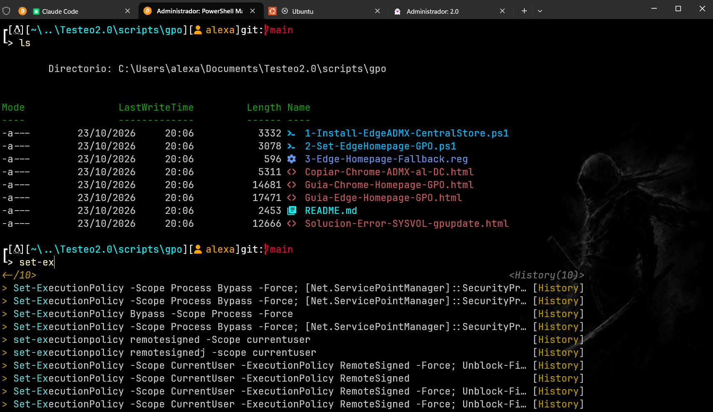

<div align="center">


# VORTERM 7.5

From clean Windows to a modern dev shell. One command.

   



</div>

##  Install

```powershell
Set-ExecutionPolicy -Scope Process Bypass -Force; [Net.ServicePointManager]::SecurityProtocol=3072; $f="$env:TEMP\vorterm-bootstrap.ps1"; irm https://raw.githubusercontent.com/4leX-42/Vorterm/main/bootstrap.ps1 -OutFile $f; & $f
```

Nothing changes until **INSTALL**. Idempotent: re-running leaves what is already in place. Or `INSTALAR.bat` from the repo.

##  Stack

| | |
|---|---|
|  **Core** | PowerShell 7 · Windows Terminal · Git |
|  **Shell** | oh-my-posh (bundled theme, offline) · JetBrainsMono Nerd Font · PSReadLine · Terminal-Icons · posh-git |
|  **Optional** | VS Code · Neovim · 7-Zip · GitHub Desktop · WSL · Node.js LTS · Claude Code · Codex CLI · Antigravity |
|  **Multi-pane** | `m2` `m3` `m4` · `-Rows` · `-Claude` · `close 2` · `/commands` |
|  **Session restore** | Tabs, panes, folders and Claude Code sessions come back after a reboot or crash |
|  **Reset** | Removes only what Vorterm added; your profile lines and LAB folder stay |

Your PowerShell profile is kept: Vorterm only manages the block between `# >>> vorterm >>>` and `# <<< vorterm <<<`.

<details>
<summary> <b>Unattended</b></summary>

```powershell
powershell -ExecutionPolicy Bypass -STA -File .\setup_terminal.ps1 -NoGui
powershell -ExecutionPolicy Bypass -STA -File .\setup_terminal.ps1 -NoGui -Node -ClaudeCode -LabRoot "$env:USERPROFILE\Desktop"
```

Options, updates and recovery: [docs/INSTALL.md](docs/INSTALL.md).
</details>

<details>
<summary> <b>Multi-pane and session restore</b></summary>

One Windows Terminal window, several panes of a hidden black profile. On by default.

| Command | What it does |
| :-- | :-- |
| `m2` / `m3` / `m4` | 2 or 3 columns, or a 2x2 grid, maximized |
| `-Rows` | stack the panes as rows (vertical monitor) |
| `-Claude` | start Claude Code in every pane |
| `close 2` | close pane 2 from any pane (`close 2 3` for several) |
| `/commands` | cheat sheet in the terminal |
| `Ctrl+Shift+3 / B / Z` | split in 3 · type in all panes · zoom pane (only if the keys were free) |

After a reboot, crash or forced close, each pane goes back to its folder and resumes its Claude Code session (`claude --resume <id>`, also in `~\.claude2`). `/exit` clears the record: only interrupted sessions come back. Claude Code hooks are added only to existing profiles; your own hooks stay.
</details>

<details>
<summary> <b>Claude Code config</b></summary>

Tick **claude code config** (also ticks **claude code** and **node.js lts**):

| | |
| :-- | :-- |
| Permissions | `bypassPermissions` by default, no start-up warning, in `~\.claude` and `~\.claude2`; deny rules for `.env`, SSH keys, certificates and cloud credentials |
| Plugins | security-guidance, feature-dev, claude-md-management, microsoft-docs, frontend-design |
| MCP and tools | codebase-memory-mcp, context7, agent-browser, gitleaks, ripgrep |
| Output trimming | [RTK](https://github.com/rtk-ai/rtk) hook rewrites shell commands to `rtk <command>`; `grep` and `curl` left alone |
| Second profile | `claude2` (`~\.claude2`, same stack) |
| Status line | 5-hour / weekly usage and context percent, only if you have none |
| Workspace | `Documents\claude-lab` with `CLAUDE.md`, templates and git-ignored `privado` / `_archivo` |

> **Warning:** with `bypassPermissions` Claude runs commands and edits files without asking, including what a plugin or a prompt injection in a page or repo tells it to do. Deny rules still apply. Untick to keep permission prompts; the `disableBypassPermissionsMode` policy overrides it.

Engine: [Claude Code Setup Guide](https://github.com/4leX-42/ClaudeCode_SETUP) (`profiles/essentials.json`). Standalone: `claude\Set-VortermClaude.ps1`.
</details>

<details>
<summary> <b>Lab</b></summary>

Tick **lab** and pick a folder: Vorterm creates `<folder>\LAB`, a working structure for Azure, Microsoft 365, Exchange, Intune, security, Power Automate, CloudOps, PowerShell and DevOps, with `CLAUDE.md`, area rules, templates (runbook, change plan, incident, postmortem, project, script, KQL) and fictitious examples. Local files only, never overwrites your edits. Standalone: `lab\New-VortermLab.ps1 -Root D:\Work`. Details: [docs/LAB.md](docs/LAB.md).
</details>

<details>
<summary> <b>Reset</b></summary>

Removes its profile block, module copies, the Mosaic profile and shortcuts, session restore scripts and hooks, and returns Windows Terminal settings to their previous state (a `.before-reset-*` copy is kept). Claude Code config and the LAB folder are kept.
</details>

<div align="center">

<sub>MIT © Vorterm · [Changelog](CHANGELOG.md)</sub>

</div>
